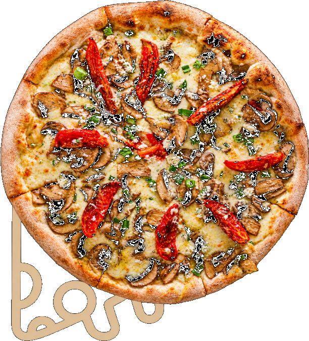

# Pizza Pietra — Sitio Web

Esta es la página web de Pizza Pietra. Esta guía está pensada para alguien
**sin conocimientos de programación**: te explica, paso a paso, dónde tocar
cada cosa cuando necesites actualizar algo.

## Cómo ver la página

Hacé doble clic en el archivo **`index.html`**. Se abre directo en tu
navegador (Chrome, Edge, etc.) y funciona completa, sin necesidad de
internet ni de instalar nada.

---

## 📁 ¿Dónde está cada cosa?

```
pizza-pietra/
│
├── index.html          → La estructura de la página (secciones, textos fijos)
├── README.md            → Este instructivo
│
├── css/
│   └── styles.css        → Los colores, tipografías y el diseño visual
│
├── js/
│   └── script.js          → La "lógica" que arma las tarjetas automáticamente
│
├── data/
│   └── menu.js            → ⭐ ACÁ SE CAMBIAN LOS PRECIOS Y PRODUCTOS ⭐
│
└── img/
    ├── logo-verde.png, logo-naranja.png, nosotros.png
    ├── pizza-giratoria.png → La pizza que gira al lado del título de Catering
    ├── productos/          → Fotos de pizzas, boxes y tortas
    └── galeria/            → Fotos de la galería
```

**Regla de oro: el 95% de las actualizaciones se hacen en un solo archivo:
`data/menu.js`.** No hace falta tocar nada más.

---

## ✏️ Cómo cambiar precios o productos (archivo `data/menu.js`)

Abrí el archivo `data/menu.js` con el Bloc de Notas (clic derecho → Abrir
con → Bloc de notas) o con cualquier editor de texto.

Vas a ver bloques de texto organizados con `{ llaves }`, comas `,` y
comillas `" "`. Solo necesitás cambiar lo que está **entre comillas** o
**los números de precio**. No borres las comillas, comas ni llaves.

### 1) Cambiar un precio existente

Buscá el producto, por ejemplo:

```js
{ etiqueta: "Unidad", precio: 12000 },
```

Para cambiar el precio, modificá solamente el número (sin puntos ni
comas, sin el signo $):

```js
{ etiqueta: "Unidad", precio: 13500 },
```

### 2) Agregar una torta nueva

Buscá la lista de tortas (`tortas: { lista: [ ... ] }`) y agregá una línea
nueva, copiando el formato de las demás. Ojo con la coma al final de cada
línea (menos en la última):

```js
{ nombre: "Torta de limón", precio: 40000 },
```

### 3) Quitar un producto

Borrá el bloque completo de ese producto (desde la `{` hasta la `}` que le
corresponde, incluyendo la coma). Si tenés dudas, es más seguro dejar el
producto y simplemente subirle mucho el precio, o pedirle a alguien que
sepa programación que revise el cambio.

### 4) Cambiar el número de WhatsApp

Buscá esta línea, cerca del principio del archivo:

```js
whatsappInternacional: "5493518355245",
whatsappVisible: "351 835-5245",
```

- `whatsappInternacional`: siempre empieza con `549` + código de área (sin
  el 0) + número (sin el 15). Ejemplo para Córdoba: `549` + `351` + número.
- `whatsappVisible`: es el número tal cual se muestra en pantalla al
  usuario, podés escribirlo con espacios y guiones.

> **Nota:** la página tiene un solo botón de WhatsApp por sección (por
> ejemplo, "Hacé tu pedido por WhatsApp" en Take Away, o el botón flotante
> verde que aparece en toda la página) en vez de un botón repetido en
> cada producto. Todos usan el mismo número de `whatsappInternacional`.

### 5) Cambiar el email o Instagram

```js
instagramUrl: "https://www.instagram.com/pizzapietracba/",
instagramVisible: "@pizzapietracba",
email: "pizzaspietra@gmail.com",
```

Cambiá el texto entre comillas por el nuevo dato.

### 6) Cambiar textos (hero, "sobre nosotros", etc.)

Más abajo en el archivo vas a encontrar `textos: { ... }` con frases como
la descripción del negocio o los puntos de "Sobre Nosotros". Cambiá el
texto entre comillas por el que quieras, respetando las comillas al
principio y al final.

---

## 🖼️ Cómo cambiar las fotos

Todas las fotos que se ven en la página hoy son **placeholders** (imágenes
de relleno con un cartel que dice "FOTO PLACEHOLDER"), para que sepas
exactamente dónde falta poner una foto real.

Para reemplazar una foto:

1. Conseguí tu foto real (formato `.jpg` o `.png`, no muy pesada, ideal
   menos de 1 MB).
2. Copiala dentro de la carpeta correspondiente:
   - Fotos de productos → `img/productos/`
   - Fotos de la galería → `img/galeria/`
   - Foto de los hermanos → `img/` (reemplaza a `nosotros.svg`)
3. Abrí `data/menu.js` y cambiá la ruta de esa imagen para que apunte a tu
   archivo nuevo. Por ejemplo, si tu foto se llama `pizza-real.jpg` y la
   pusiste en `img/productos/`:

```js
imagen: "img/productos/pizza-real.jpg",
```

   También podés simplemente **renombrar tu foto nueva con el mismo
   nombre** que el placeholder que reemplaza (por ejemplo
   `pizza-freezada.jpg`) — en ese caso no hace falta tocar `menu.js` en
   absoluto, pero vas a tener que cambiar la extensión en esa misma línea
   de `.svg` a `.jpg` (o `.png`, según corresponda).

Para la foto de "Sobre Nosotros", reemplazá el archivo `img/nosotros.png`
por tu foto y actualizá esta línea dentro de `index.html`:

```html

```

cambiando `img/nosotros.png` por, por ejemplo, `img/nosotros.jpg`.

La pizza que gira al lado del título de "Catering" es `img/pizza-giratoria.png`
(una foto real, sin fondo, que incluye el garabato decorativo — gira todo
junto como una sola imagen). Si más adelante querés cambiarla por otra
foto, buscá esta línea en `index.html`:

```html

```

y cambiá `img/pizza-giratoria.png` por la ruta de tu foto nueva. Para que
gire bien, conviene que la foto sea de una pizza vista **desde arriba**,
**bien redonda y centrada**, y sin fondo (o con fondo liso, fácil de recortar).

---

## 🍕 Sabores de pizza e ingredientes

La lista completa de sabores está en `data/menu.js`, dentro de
`pizzaSabores`. En la página, cada sabor aparece como un botón (dentro de
"Ver todos los sabores de pizza disponibles", en la sección Catering): al
tocarlo o hacerle clic, se abre una ventana con sus ingredientes.

Cada sabor tiene este formato:

```js
{
  nombre: "Margarita",
  vegetariana: true,
  ingredientes: ["Salsa de tomate", "Fior di latte", "Albahaca fresca", "Aceite de oliva"]
},
```

- `nombre`: el nombre del sabor.
- `vegetariana`: `true` le agrega la etiqueta "V" (vegetariana); si no lo
  es, poné `false`.
- `ingredientes`: la lista de ingredientes que se muestra en la ventana
  emergente. Para agregar un ingrediente, sumá un texto entre comillas
  dentro de los corchetes `[ ]`, separado por comas. Para quitarlo, borrá
  ese texto (y la coma que le sobre). El orden en que los escribas es el
  orden en que se muestran.

Para agregar un sabor nuevo o quitar uno, sumá o borrá el bloque completo
`{ ... }` copiando el mismo formato (cuidando las comas entre bloques).

---

## 🎉 Catering: entradas, principales y requisitos

También en `data/menu.js`, dentro de `catering`, vas a encontrar las listas
de `entradas` y `principales`, y más abajo la lista `requisitos` (seña,
mínimo de personas, qué incluye el servicio, etc.). Se editan de la misma
forma: cambiando el texto entre comillas.

Si una entrada o principal es exclusiva del Servicio Premium (como las
Brusquetas), tiene que tener `soloPremium: true`. Si es una opción normal,
`soloPremium: false`.

---

## ⚠️ Errores comunes al editar `menu.js`

Si después de editar el archivo la página deja de funcionar (se ve en
blanco o rota), revisá que no hayas:

- Borrado una coma `,` entre productos.
- Borrado una comilla `"` de apertura o cierre.
- Dejado una coma de más después del último elemento de una lista (antes
  del `]` o `}` de cierre).

**Tip:** si algo se rompe, lo más simple es deshacer el último cambio que
hiciste (Ctrl+Z en el Bloc de Notas, si todavía no cerraste el archivo) y
volver a intentarlo con más cuidado.

---

## 🎨 Cambiar colores o estilos (avanzado)

Si en algún momento querés cambiar los colores generales del sitio, están
todos definidos juntos al principio del archivo `css/styles.css`, en la
sección `:root`. Esto ya requiere un poco más de cuidado y conocimientos
de CSS.

---

## 🧱 Tecnologías usadas

Este sitio está hecho **100% con HTML, CSS y JavaScript puro** (sin
React, sin Bootstrap, sin frameworks). Por eso funciona abriendo
directamente el `index.html`, sin necesidad de instalar nada ni de tener
conexión a internet (salvo para cargar las tipografías de Google Fonts).

Cualquier programador podrá entender y modificar este código sin
dificultad si en el futuro necesitás una función más avanzada (por
ejemplo, un carrito de compras o un panel de administración).
